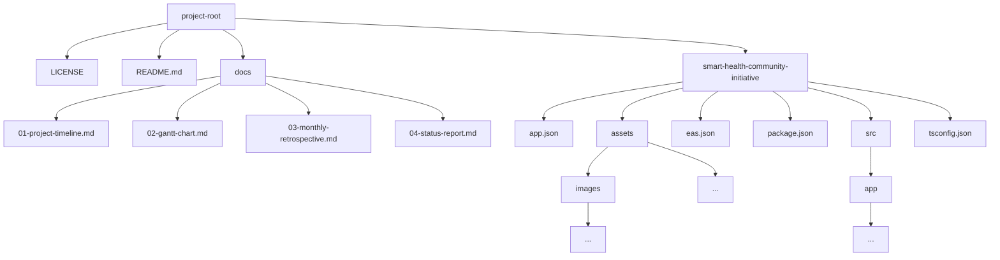

# Smart-Health-Community-Initiative

> An iOS/Android React Native mobile app to encourage community members around Ireland to engage in healthy exercise, such as walking or running.

---

## Project Details

| Field                  | Detail                                                                                                            |
| ---------------------- | ----------------------------------------------------------------------------------------------------------------- |
| **Student Name**       | Darian Byrne                                                                                                      |
| **Student ID**         | C00296036                                                                                                         |
| **Supervisor**         | Omer Ali                                                                                                          |
| **Programme / Module** | BSc (Hons) in Software Development - Final Year Project                                                           |
| **Academic Year**      | 2026-2027                                                                                                         |
| **Meeting Schedule**   | Weekly, Tuesday 11:00-11:20                                                                                       |
| **Repository**         | [DarianByrne/Smart-Health-Community-Initiative](https://github.com/DarianByrne/Smart-Health-Community-Initiative) |

---

## Project Scope

**Problem statement.** The average person knows that regular exercise is important but is often unmotivated to get it.

**Aim.** To encourage community members around Ireland to engage in healthy exercise, such as walking or running.

**Objectives**

- [ ] Users can discover groups that are local or relevant to them.
- [ ] The app encourages users to contribute to their group(s) leaderboard.
- [ ] Using the app is frictionless and doesn't cost the user's time.

### In Scope

- Account creation with Google/Apple.
- Discover local groups.
- Group leaderboards on a regular basis.
- Create and manage groups.
- Connection with phone's health provider.
- Encouraging push notifications.

create accounts, discover or establish groups, connect their phone’s health platform, and record their exercise activity. Group-based leaderboards and daily or weekly challenges will encourage participation, track progress, and provide a shared sense of achievement

### Out of Scope

- Instant messaging. This doesn't massively improve the core idea and requires moderation, performant databases, caching, reliability.
- Connecting with third party platforms like Strava, Peloton, Nike Run Club. This requires connecting with their APIs, which are often not available/open.
- Detailed exercise analytics. This information is available from the phone’s health provider.
- Website/dashboard. Focusing on the mobile app experience results in better UX.

---

## Brief Summary

Regular physical activity is essential for maintaining good health and wellbeing, yet many people struggle to stay motivated and maintain consistent exercise habits. Community-based initiatives in Ireland, such as the National Transport Authority’s Marchathon and Walktober, demonstrate the potential of group activities to encourage healthier lifestyles. This project intends to build on these initiatives through a more interactive and accessible digital platform.

This project proposes the development of a cross-platform mobile app that encourages walking and running by connecting people with local communities and promoting friendly exercise competitions. It will be developed using React Native, TypeScript, and Expo, with Supabase providing user authentication, backend services, and database management. Users will be able to create accounts, discover or establish groups, connect their phone’s health platform, and record their exercise activity. Group-based leaderboards and daily or weekly challenges will encourage participation, track progress, and provide a shared sense of achievement.

Key deliverables include

- Functional mobile app
- Exercise data integration
- Backend database
- User authentication
- Group management
- Walking-based leaderboards

The outcome of the project is an accessible, community-driven fitness platform that makes exercise more engaging, strengthens social connections, and supports healthier habits among people across Ireland. The project will also explore the technical and privacy considerations involved in developing a secure, cross-platform health application.

---

## Technologies Used

| Layer                        | Technology           | Purpose / Notes     |
| ---------------------------- | -------------------- | ------------------- |
| **Language(s)**              | TypeScript           | Core implementation |
| **Frontend**                 | React Native         | User interface      |
| **Backend / API**            | Node.js, Express     | Application logic   |
| **Database**                 | PostgreSQL, Supabase | Data storage        |
| **Infrastructure / Hosting** |                      | Deployment          |
| **Testing**                  |                      | Quality assurance   |
| **Tooling / DevOps**         | Git, GitHub          | Version control     |
| **Libraries / Frameworks**   | Expo                 | Key dependencies    |

---

## Repository Structure



<details>
<summary>Plain-text fallback (if the tree above does not render)</summary>

```text
.
├── LICENSE
├── README.md
├── docs
│   ├── 01-project-timeline.md
│   ├── 02-gantt-chart.md
│   ├── 03-monthly-retrospective.md
│   └── 04-status-report.md
└── smart-health-community-initiative
    ├── assets
    │   ├── ...
    │   └── images
    │       └── ...
    ├── src
    │   └── app
    │       └── ...
    ├── app.json
    ├── eas.json
    ├── package.json
    └── tsconfig.json
```

Tree command

```bash
git ls-tree -r --name-only HEAD | tree --fromfile
```

</details>

---

## Project Tracking & Reports

All ongoing project management lives in [`/docs`](./docs).

| Document                                                    | What it is                                      | Update cadence    |
| ----------------------------------------------------------- | ----------------------------------------------- | ----------------- |
| [Project Timeline](./docs/01-project-timeline.md)           | Phases and milestones across the whole project  | At each milestone |
| [Gantt Chart](./docs/02-gantt-chart.md)                     | Scheduled tasks with durations and dependencies | Fortnightly       |
| [Monthly Retrospective](./docs/03-monthly-retrospective.md) | What went well / to improve / actions (Kanban)  | Monthly           |
| [Status Report](./docs/04-status-report.md)                 | Current work + last week's tasks (Kanban)       | Weekly            |

---

## Getting Started

# Prerequisites

1. [Node.js](https://nodejs.org/download)
2. Package manager ([npm](https://www.npmjs.com/), [Yarn](https://yarnpkg.com/), or [pnpm](https://pnpm.io/))

# Clone

```bash
git clone https://github.com/DarianByrne/Smart-Health-Community-Initiative.git
cd Smart-Health-Community-Initiative/smart-health-community-initiative
```

# Install

```bash
npm install
```

# Run

```bash
npm run start
```
