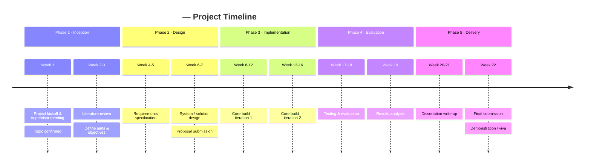

# Project Timeline

> **Purpose:** A high-level, chronological view of the whole project — the phases and the key milestones within them. Unlike the [Gantt chart](./02-gantt-chart.md) (which tracks scheduled task durations), the timeline is about _when the big moments happen_.
>
> **Update:** At the start of the project, then whenever a milestone is reached or a date shifts.

**Last updated:** _YYYY-MM-DD_ · **Maintained by:** _\<Your name\>_

---

## Timeline at a Glance

_Replace the example entries below with your own phases and events. Each `section` is a phase; each line is `Period : Event : Event`._

---

## Phase Summary

| Phase              | Dates (from–to)           | Key outcome              | Status |
| ------------------ | ------------------------- | ------------------------ | ------ |
| 1 · Inception      | _YYYY-MM-DD → YYYY-MM-DD_ | _Confirmed topic & plan_ | 🟡     |
| 2 · Design         | _…_                       | _Approved design_        | ☐      |
| 3 · Implementation | _…_                       | _Working build_          | ☐      |
| 4 · Evaluation     | _…_                       | _Validated results_      | ☐      |
| 5 · Delivery       | _…_                       | _Submitted & demoed_     | ☐      |

---

## Change Log

_Record any significant date or scope change so the history is visible._

| Date         | Change                  | Reason                                            |
| ------------ | ----------------------- | ------------------------------------------------- |
| _YYYY-MM-DD_ | _e.g. M4 moved +1 week_ | _e.g. API integration took longer than estimated_ |
