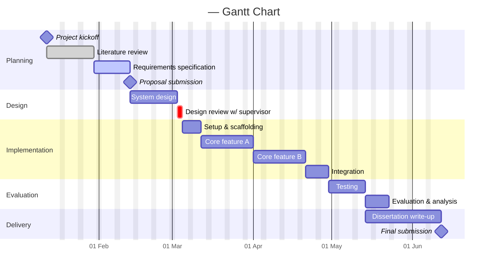

# Project Gantt Chart

> **Purpose:** A schedule of the actual _tasks_ — their durations, order, and dependencies. This is where planning meets reality: set your plan, then keep it honest by marking tasks `done`/`active` and adjusting dates as things move.
>
> **Update:** Fortnightly (or whenever tasks start/finish). Pull the task list from your **shared meeting sheet**.

**Last updated:** _YYYY-MM-DD_ · **Maintained by:** _\<Your name\>_

---

## Schedule

_Edit the sections and tasks below. Syntax reference is at the bottom of this file._

