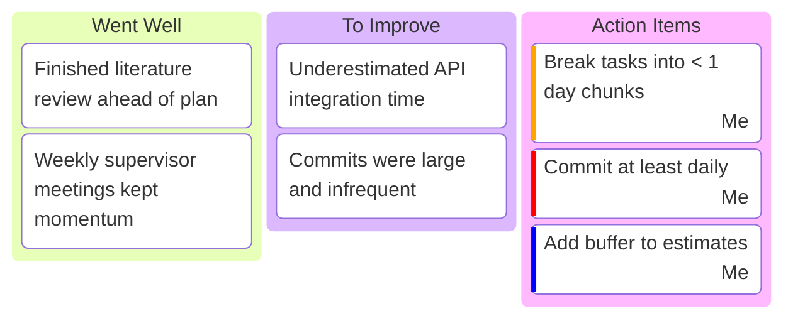

# Monthly Retrospective

> **Purpose:** Once a month, step back and reflect: what worked, what didn't, and what you will change. This is where you turn experience into action. Keep every month's retro below (newest at the top) so the growth is visible across the project.
>
> **Update:** Monthly. Base it on the month's meeting notes and your weekly [status reports](./04-status-report.md).

**Maintained by:** _\<Your name\>_

---

## How to use this file

Copy the **"Retrospective Template"** block at the bottom for each new month and paste it directly under this line, so the most recent month is always first.

---

## Retrospective — \<Month YYYY\>

**Period covered:** _YYYY-MM-DD → YYYY-MM-DD_ · **Milestones hit this month:** _M2, M3_

### Board

### Reflection

- **Biggest win:** _…_
- **Biggest challenge:** _…_
- **What I learned:** _…_
- **Carry-over to next month:** _…_

### Metrics _(optional)_

| Metric               | This month | Target |
| -------------------- | ---------- | ------ |
| Milestones completed | _2 / 2_    | _…_    |
| Commits              | _…_        | _…_    |
| Hours logged         | _…_        | _…_    |
