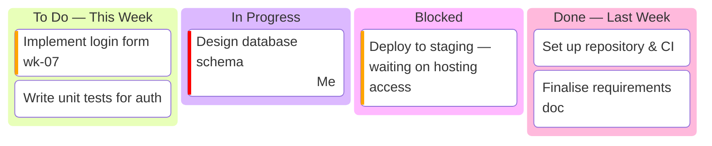

# Project Status Report

> **Purpose:** Your living, week-by-week record of progress. It answers three questions your supervisor asks every meeting: _What did you do? What are you doing now? What is blocking you?_ The tasks come from your **shared meeting sheet** (minutes of meetings) — copy them here and track them to completion.
>
> **Update:** Weekly (or fortnightly), before each supervisor meeting. Keep the newest report at the top.

**Maintained by:** _\<Your name\>_

---

## How to use this file

1. Each meeting cycle, copy the **"Status Report Template"** at the bottom and paste it directly under this line (newest first).
2. Move cards across the Kanban board to reflect reality.
3. Make sure every task from the meeting sheet appears somewhere on the board.

---

## Status Report — Week of \<YYYY-MM-DD\>

**Reporting period:** _YYYY-MM-DD → YYYY-MM-DD_ · **Next meeting:** _YYYY-MM-DD_ · **Overall health:** 🟢 On track

### Progress Board

### Questions for supervisor

- _…_

### Notes from this week's meeting

- _Key decisions / advice captured here, then transferred into tasks above._
